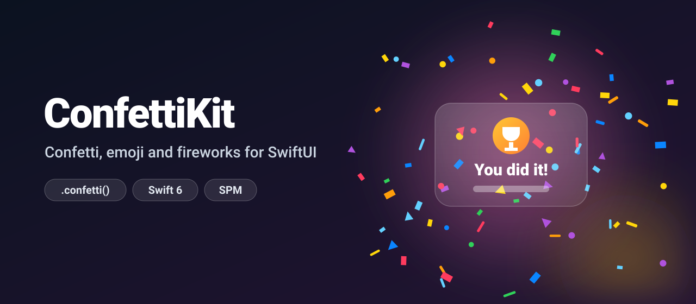
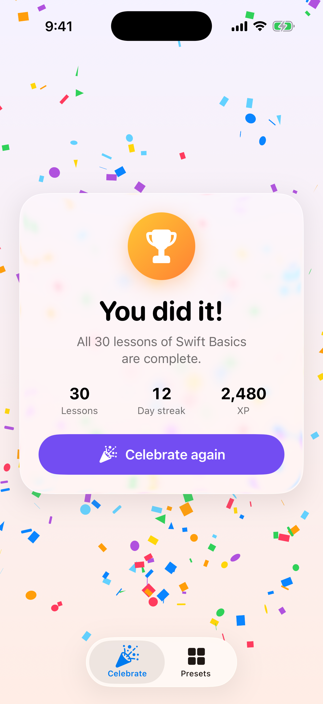
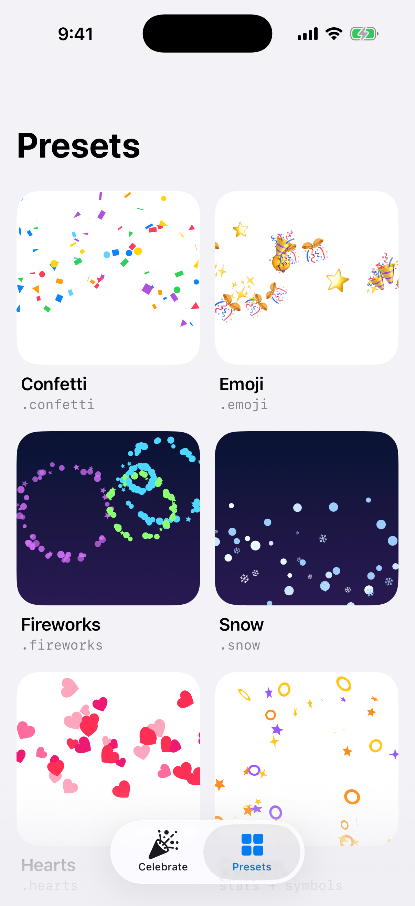
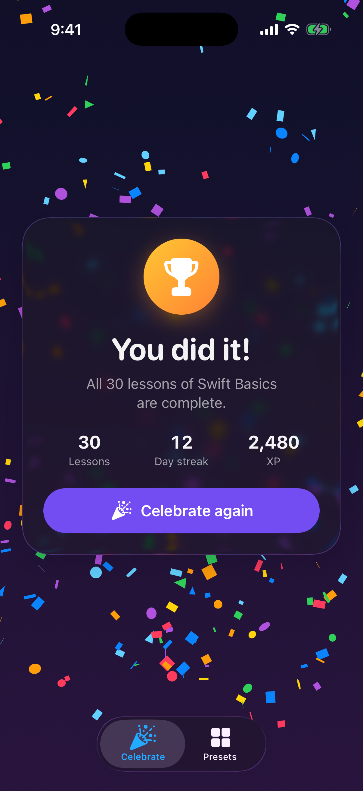
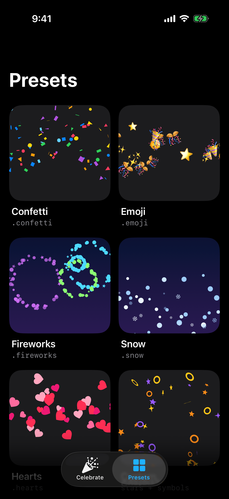

<p align="center">
  
</p>

<p align="center">
  <a href="https://github.com/halilozel1903/ConfettiKit/actions/workflows/ci.yml"></a>
  
  
  
  
  <a href="LICENSE"></a>
</p>

**ConfettiKit** adds confetti, emoji bursts, fireworks, snow and floating hearts to any SwiftUI view. One modifier fires an effect whenever a value changes. Particles are drawn with `Canvas` and `TimelineView`, move with real gravity and air resistance, and come from a seeded simulation, so any moment can be reproduced exactly. Reduce Motion gets a gentle glow instead, and iPhone users feel a haptic on every burst.

```swift
Button("Complete lesson") { completed += 1 }
    .confetti(trigger: completed)
```

## Screenshots

Captured from the example app on an iOS 26 simulator by CI.

| Celebration | Presets |
| :---: | :---: |
|  |  |
|  |  |

## Features

- **`.confetti(trigger:)`** on any view: fires whenever the value changes, stacks bursts when it changes again, and costs nothing between bursts.
- **Five presets**: `.confetti`, `.emoji`, `.fireworks`, `.snow` and `.hearts`, plus `.cannon(from:angle:)` and `.emoji([...])` for your own emoji.
- **Any particle**: paper rectangles, ribbons, dots, triangles, stars, hearts, emoji, SF Symbols or your own `Shape`.
- **Real motion**: gravity, air drag with a terminal velocity, spin, a 3D tumble, sideways sway and a fade out.
- **Any emitter**: a point, a line along an edge or a rectangle; several staggered bursts for fireworks.
- **Reduce Motion aware**: a soft glow in the effect's colors fades in and out instead of moving particles.
- **Haptics**: any `SensoryFeedback` on each burst, `.success` by default.
- **Deterministic**: a seeded generator and a closed-form simulation. Freeze any moment for previews, snapshot tests and screenshots.
- **Safe configuration**: every value is clamped, and `NaN`, infinity or empty arrays fall back to defaults.
- **Swift 6 strict concurrency**, zero dependencies, iOS 17+ and macOS 14+.
- **Tested** with Swift Testing: the random generator, the motion math, emission and configuration clamping.

## Installation

### Swift Package Manager

In Xcode choose **File › Add Package Dependencies…** and enter:

```
https://github.com/halilozel1903/ConfettiKit
```

Or add it to `Package.swift`:

```swift
dependencies: [
    .package(url: "https://github.com/halilozel1903/ConfettiKit", from: "1.0.0")
]
```

## Quick start

```swift
import ConfettiKit
import SwiftUI

struct LessonView: View {
    @State private var finished = 0

    var body: some View {
        VStack {
            LessonContent()
            Button("Finish") { finished += 1 }
        }
        .frame(maxWidth: .infinity, maxHeight: .infinity)
        .confetti(trigger: finished)
    }
}
```

The effect is drawn in an overlay the size of the view you attach it to. It ignores touches and is hidden from VoiceOver, so put it on a view that covers the area you want, often the screen's root view.

## Usage

### The modifier

```swift
.confetti(trigger: score)                                   // paper confetti, success haptic
.confetti(.fireworks, trigger: level)                       // any preset
.confetti(.hearts, trigger: likes, haptic: .impact(weight: .light))
.confetti(.emoji(["🍕", "🎈"]), trigger: orders, haptic: nil)
.confetti(.snow, trigger: isWinter, seed: 42)               // the same layout every time
```

`trigger` can be any `Equatable` value. The effect fires when it changes, not when the view appears. A counter is the simplest trigger: a `Bool` fires on both `true` and `false`.

Stack modifiers to combine effects:

```swift
CelebrationBackground()
    .confetti(trigger: wins)
    .confetti(.cannon(from: .bottomLeading, angle: 30), trigger: wins, haptic: nil)
    .confetti(.cannon(from: .bottomTrailing, angle: -30), trigger: wins, haptic: nil)
```

### Presets

| Preset | Effect |
| --- | --- |
| `.confetti` | Paper confetti bursting up from the middle, then fluttering down |
| `.emoji` / `.emoji([...])` | A burst of emoji that stay flat and do not tumble |
| `.fireworks` | Four shells bursting across the top half, one color each |
| `.snow` | Flakes and snowflake symbols drifting down from the top edge |
| `.hearts` | Hearts floating up from the bottom edge |
| `.cannon(from:angle:)` | A narrow, fast jet from any point |

### Custom effects

Start from a preset and change what you need:

```swift
var party = ConfettiConfiguration.confetti
party.count = 220
party.colors = [.indigo, .mint, .yellow]
party.shapes = [.star, .circle, .symbol("sparkle"), .emoji("🎈")]
party.emitter = .point(UnitPoint(x: 0.5, y: 1))   // from the bottom edge
party.angle = 0                                    // degrees: 0 up, 90 right, 180 down
party.spread = 50
party.speed = 900...1400                           // points per second
```

Or build one from scratch:

```swift
let glitter = ConfettiConfiguration(
    count: 120,                          // particles per burst, 1...400
    shapes: [.star, .circle],
    colors: [.yellow, .orange],
    size: 4...9,                         // points
    emitter: .top,                       // .center, .top, .bottom, .point(_:) or any rectangle
    angle: 180,
    spread: 40,
    speed: 40...120,
    emissionDuration: 2,                 // release particles over 2 seconds
    bursts: 1,                           // more than 1: staggered, clustered bursts
    gravity: 120,                        // points/s², negative floats up
    drag: 1.2,                           // terminal speed = gravity / drag
    spin: 1,                             // turns per second
    tilt: 180,                           // starting rotation, degrees either way
    flip: 2,                             // 3D tumble, turns per second; 0 keeps particles flat
    wobble: 12,                          // sideways sway in points
    lifetime: 5,                         // seconds
    fadeOut: 0.3                         // last 30 % of each life fades out
)
```

All values are clamped, so no configuration can break the effect. `scaled(by:)` multiplies every distance, so a full-screen preset fits a small card:

```swift
ConfettiView(.confetti.scaled(by: 0.4))
```

### Custom shapes

```swift
let pill = ConfettiCustomShape(id: "pill", Capsule())
let ring = ConfettiCustomShape(id: "ring") { rect in
    Path(ellipseIn: rect).strokedPath(StrokeStyle(lineWidth: rect.width * 0.2))
}
party.shapes = [.custom(pill), .custom(ring), .heart]
```

Emoji ignore the colors; SF Symbols and shapes are tinted with them.

### A view that plays on appear

```swift
ZStack {
    SuccessCard()
    ConfettiView(.fireworks)          // plays once when it appears
}
```

Give it a new `.id(_:)` to play it again.

### Reduce Motion and haptics

With **Reduce Motion** on, no particle moves: a soft glow in the effect's colors (and its first emoji, if it has one) fades in and out where the effect starts. Set `respectsReduceMotion = false` only for effects that are essential and slow, such as snow.

`haptic` takes any `SensoryFeedback`: `.success` by default, `nil` for none. Bursts from stacked modifiers each play their own, so pass `nil` to all but one.

### Previews, snapshot tests and screenshots

Freeze an effect at any moment. With a seed, every render is identical:

```swift
ConfettiView(.fireworks.frozen(at: 1.2), seed: 7)
```

### Use the simulation on its own

The math has no SwiftUI dependency and is fully unit tested. Positions are computed in closed form from the elapsed time, so frames are independent of the frame rate:

```swift
let particles = ConfettiSimulation.particles(for: .confetti, seed: 42)
let state = ConfettiSimulation.state(
    of: particles[0],
    at: 0.8,                                  // seconds since firing
    in: CGSize(width: 400, height: 800),
    physics: ConfettiConfiguration.confetti.physics
)                                             // position, rotation, flip, opacity, or nil

ConfettiSimulation.displacement(velocity: -900, acceleration: 750, drag: 1.1, time: 0.5)
ConfettiSimulation.duration(of: particles)    // when the last particle is gone
```

## How it works

When the trigger changes, the modifier generates the burst's particles once from a seeded SplitMix64 generator: origin, launch velocity, size, spin, tumble, sway, color and shape. Nothing about a particle is stored per frame. A `TimelineView` redraws a `Canvas` while a burst is alive, and each particle's position comes from the exact solution of motion under gravity with linear drag, `v·e^(−kt) + (g/k)(1 − e^(−kt))`, so particles slow down, reach a terminal speed and flutter instead of falling ever faster. Text and symbols are resolved once per frame and reused by every particle. When the last particle has faded, the burst is removed and the timeline stops.

## Example app

The `Example` folder contains a demo app with a "You did it!" screen (tap **Celebrate again**) and a gallery of every preset (tap a tile to replay it). It uses [XcodeGen](https://github.com/yonaskolb/XcodeGen) so no project file has to live in the repo:

```bash
brew install xcodegen
cd Example && xcodegen generate
open ConfettiKitDemo.xcodeproj
```

## Requirements

- Xcode 26 or later (Swift 6.2 toolchain)
- iOS 17+ / macOS 14+

## Contributing

Issues and pull requests are welcome. Please run `swift test` before opening a PR.

## License

ConfettiKit is available under the MIT license. See [LICENSE](LICENSE).
